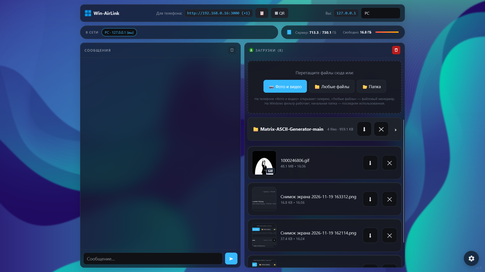

# 🪟 Win-AirLink v1.1 / Coming soon... update v1.2

**A lightweight local file-sharing and messaging app for Windows and Android/iOS.**

Win-AirLink — это легковесная альтернатива AirDrop для передачи файлов, папок, фотографий и сообщений между компьютером и смартфоном через локальную сеть Wi-Fi.

Без проводов, облачных хранилищ, регистрации и сторонних мессенджеров. Только ваши устройства и локальная сеть.

**Один сервер. Несколько устройств. Быстрый обмен файлами.**

---

Никаких проводов, облаков, интернета и регистраций. Только ваш роутер и браузер.

---

v1.1

V1.0

## ✨ Возможности

### 📁 Передача файлов
- Передача файлов между Windows и Android/iOS.
- Отправка фотографий и видео в один клик.
- Передача целых папок с сохранением структуры.
- Просмотр содержимого папок прямо в интерфейсе.
- Миниатюры изображений и видео.
- Статичные превью GIF без воспроизведения тяжёлой анимации.
- Поддержка различных типов файлов.
- Возможность скачивать отдельные файлы и целые папки.

### 📊 Система загрузок
- Плавное отображение прогресса передачи.
- Синхронизация прогресса между подключёнными клиентами.
- Процент загрузки в отдельной синей плашке.
- Полупрозрачная индикация прогресса.
- Голубое свечение рамки после успешной загрузки.
- Звуковые уведомления о начале и завершении передачи.
- Анимация удаления файлов с красным световым эффектом.
- Удаление отдельных файлов или всего списка.

### 💬 Встроенный LAN-мессенджер
- Обмен текстовыми сообщениями между устройствами.
- Отображение подключённых клиентов.
- Индивидуальные имена устройств.
- Копирование и удаление сообщений.
- Сохранение истории сообщений после перезапуска сервера.

### 📱 Подключение устройств
- Автоматическое определение локального IP-адреса.
- Подключение через браузер.
- QR-код для быстрого подключения смартфона.
- Автоматический возврат из окна QR после подключения телефона.
- Поддержка нескольких клиентов одновременно.

---

## 🚀 Что нового в v1.1?

v1.1 — крупное обновление, которое значительно расширяет возможности приложения и добавляет гибкую настройку интерфейса.

### 🎨 Персонализация интерфейса
- Загрузка собственных обоев для фона приложения.
- Регулировка затемнения фонового изображения.
- Настройка степени размытия.
- Выбор цветового акцента интерфейса.
- Автоматическая адаптация цветового оформления под обои.
- Возможность сбросить цветовой акцент или полностью сбросить оформление и обои.
- Возможность отключить прозрачность интерфейса для повышения производительности.

### 🪟 Liquid Glass
- Полупрозрачные элементы интерфейса.
- Эффект матового стекла.
- Мягкие световые градиенты на фоне.
- Анимированное свечение границ при взаимодействии с элементами.
- Плавные переходы и микроанимации.
- Обновлённое оформление окон и панелей.

### 📂 Работа с папками
- Полноценная отправка папок.
- Раскрытие и сворачивание содержимого.
- Просмотр отдельных файлов внутри папки.
- Возможность скачивать как отдельные файлы, так и папку целиком.
- Улучшенное отображение вложенных элементов.

### ⚙️ Настройки и удобство
- Выбор отдельных папок для сохранения фотографий, видео и остальных файлов на Windows.
- Настройка прозрачности интерфейса.
- Сохранение пользовательского оформления.
- Полная локализация интерфейса на английский язык.
- Адаптация интерфейса для компьютеров и смартфонов.

### 🔊 Звуки и анимации
- Звуковое сопровождение завершения загрузки.
- Звуки удаления файлов.
- Плавная анимация удаления сообщений и файлов.
- Улучшенные эффекты свечения при взаимодействии.

---

## 📸 Интерфейс

Win-AirLink использует тёмную цветовую схему с возможностью персонализации оформления.

---

## 🛠️ Технологии

- **Backend:** Node.js.
- **Frontend:** HTML5, CSS3, Vanilla JavaScript.
- **Network:** HTTP, локальная сеть Wi-Fi.
- **Storage:** локальное хранение данных в папке `data/`.
- **Design:** Glassmorphism, Liquid Glass, CSS Animations.

---

## 🚀 Установка и запуск

### Шаг 1. Установите Node.js

Перейдите на официальный сайт:

https://nodejs.org/

Скачайте и установите LTS-версию Node.js.

### Шаг 2. Скачайте проект

Откройте репозиторий:

https://github.com/Violet-core/Win-AirLink

Нажмите `Code → Download ZIP` и распакуйте архив в удобное место.

### Шаг 3. Запустите сервер

Запустите файл:

`start.bat`

После запуска откроется консоль с информацией о сервере и локальными адресами.

- **На компьютере:** `http://localhost:3000`
- **Для телефона:** адрес локальной сети, указанный в консоли.

Важно: не закрывайте окно сервера во время использования приложения.

### Шаг 4. Подключите смартфон

1. Подключите компьютер и телефон к одной Wi-Fi сети.
2. Откройте адрес сервера в браузере телефона.
3. Либо отсканируйте QR-код с компьютера.
4. Готово! Теперь устройства подключены.

---

## 📡 Принцип работы

Win-AirLink работает внутри локальной сети.

Файлы передаются напрямую между подключёнными устройствами через компьютер, на котором запущен сервер.

Интернет, облачные хранилища и сторонние сервисы для передачи не требуются.

История сообщений и файлов сохраняется локально в папке `data/`.

---

## 📋 История версий

| Версия | Изменения |
|:---|:---|
| **v1.0** | Первоначальная версия. Передача файлов, превью, чат, QR-подключение, история и индикаторы загрузки. |
| **v1.1** | Передача папок, Liquid Glass, обои, персонализация, прозрачность, локализация, звуковые эффекты и улучшенная система загрузок. |

---

## 👨‍💻 Автор

**Made by Violet-core**

GitHub: https://github.com/Violet-core

Проект разработан для удобного обмена файлами между собственными устройствами без зависимости от сторонних мессенджеров и облачных сервисов.

---

## 📜 Лицензия

MIT License.

Используйте, модифицируйте и распространяйте проект в соответствии с условиями лицензии.
