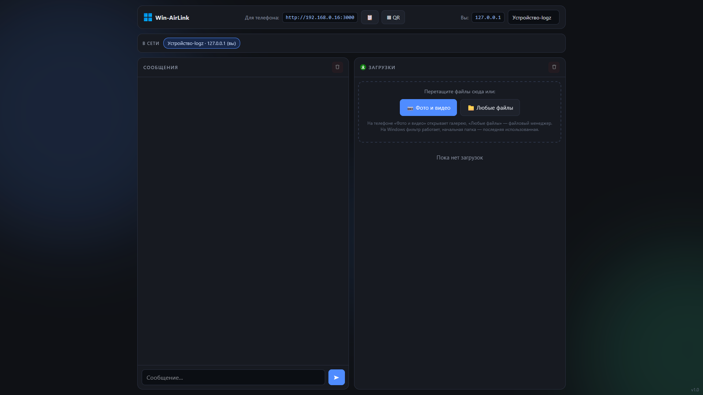

# 🪟 Win-AirLink V1.0 / v1.1 Coming soon...

**Win-AirLink** — это легковесный, быстрый и красивый аналог AirDrop для передачи файлов и сообщений по локальной сети (Wi-Fi) между ПК (Windows) и смартфоном (Android/iOS). 

Никаких проводов, облаков, интернета и регистраций. Только ваш роутер и браузер.

## ✨ Основные фишки
- **📁 Фото и видео в один клик** — отдельная кнопка сразу открывает галерею на телефоне (не нужно искать файлы по папкам).
- **🖼️ Живые превью** — миниатюры картинок и первых кадров видео подгружаются автоматически.
- **📊 Красивый прогресс** — плавная заливка плашки серым цветом по мере скачивания, процент загрузки в реальном времени.
- **💬 Встроенный чат** — обмен текстом с кнопкой быстрого копирования и удаления сообщений.
- **🔊 Звуки и анимации** — приятный звуковой сигнал и мягкое сине-голубое свечение плашки при завершении передачи.
- **💾 История** — после перезапуска сервера все сообщения и файлы остаются на месте (сохраняются в папке `data/`).
- **📱 QR-код** — для быстрого подключения телефона достаточно навести камеру.

## 🚀 Как установить и запустить

### Шаг 1: Установите Node.js (один раз)
1. Перейдите на официальный сайт: [nodejs.org](https://nodejs.org/ru)
2. Скачайте и установите **LTS-версию** (просто жмите «Далее» при установке).

### Шаг 2: Запустите сервер
1. Скачайте этот проект (нажмите зеленую кнопку **Code** -> **Download ZIP** и распакуйте в любую папку).
2. Запустите файл **`start.bat`** (двойным кликом).
3. Откроется черное окно консоли, и автоматически запустится браузер на вашем ПК с адресом `http://localhost:3000`.

> ⚠️ **Важно:** Черное окно (`server.js`) закрывать нельзя — пока оно открыто, сервер работает и передает файлы. Если хотите остановить сервер, просто закройте это окно.

### Шаг 3: Подключите телефон
1. Убедитесь, что ПК и телефон подключены к **одной и той же Wi-Fi сети**.
2. Посмотрите в шапку сайта на ПК. Там будет адрес вида `http://192.168.1.5:3000` или кнопка «QR».
3. Введите этот адрес в браузере на телефоне (Chrome, Safari) или отсканируйте QR-код.
4. Готово! Теперь вы можете перетаскивать файлы и общаться.

## 🛠️ Технологии
- **Backend:** Node.js (без внешних зависимостей, только стандартная библиотека `http`).
- **Frontend:** Чистый HTML5, CSS3, Vanilla JavaScript (без тяжелых фреймворков).
- **Стиль:** Современный Dark Mode с анимированными градиентными пятнами, Glassmorphism и плавными микроанимациями.

## 📝 Лицензия
MIT License. Используйте, изменяйте и распространяйте на здоровье!
